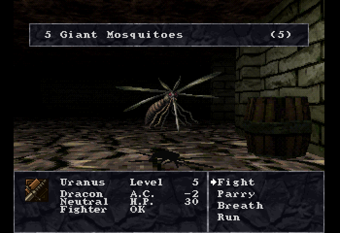
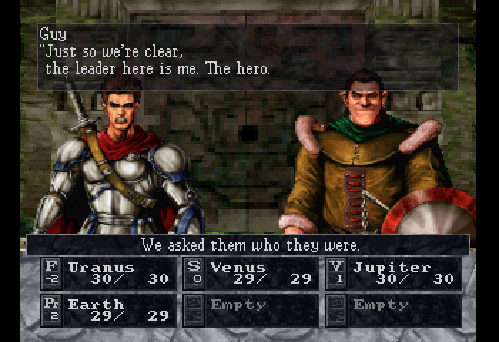
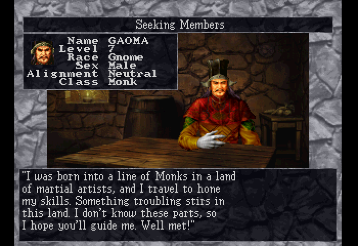

# Wizardry: Dimguil English translation

An English translation patch for Wizardry: Dimguil, the 2000 PlayStation release
(SLPS-02691). It's for the Rev 1 disc only.

  
  
  

## How it was translated

Claude, an AI model, did the first-pass machine translation and a lot of the research
behind the rewrite: the history and culture the game leans on, other games of the era,
and how the game uses kanji, hiragana and katakana. That let me decide how to handle
the jokes, how to adapt the parts that rely on something Japanese players shared at the
time and the rest of us don't, and how to keep to the intent and style of the original.
AI was also used for most of the tooling and patch code added since Remisse's work.

The usual problem with AI translation is that it reads like a machine wrote it, which
hurts a story-heavy RPG more than most games. So I'm going through the text line by
line, and I won't consider this project to be release-worthy until I have completed a
playthrough to the ending and verified everything along the way. I've already found and
resolved numerous issues with cutoffs, strange glyph placements, and other such things.

## Status

Still, this is a beta, at best. Every line of text that could be reached through a known
code path is in English, including the card game (which is kinda cool; you should check it
out!). The game can, theoretically, be played through to the end. However, that has not
been rigorously tested yet. I am currently playing through the game myself, and that will
help to uncover and resolve most of the worst bugs and translation issues. However, that
is only one playthrough, so a few things will likely slip past. I would suggest that
players looking for a "ready to play" experience wait until the v0.9.0 release, which
will drop when all of the fixes from my own playthrough are committed.

The story text has been reviewed scene by scene, and the NPC dialogue review is in
progress. The item and monster descriptions have had one check for machine-translation
habits. The menus and combat messages generally look good from my limited testing but have not
had extensive testing or review yet. Expect some rough
spots. There be dragons.

Saves on the memory card have so far carried over from one version of the patch to the
next. I make no promises that will always be the case. Save states do not carry from
version to version, especially where I've had to move around data to make various things
fit. So, load from the memory card after updating.

See [ROADMAP.md](ROADMAP.md) for what's left and [CHANGELOG.md](CHANGELOG.md) for what
changed in each release.

## Playing it

You need your own copy of the Rev 1 disc (Redump #60391), as a .cue and three .bin
files. Track 1 should have the MD5 `9eeb5c508abb23c0e3538108b7755890`. The original 2000
pressing has the same serial number and barcode, but the patch won't apply to it, and
the checksum is the most reliable way to tell them apart.

Download the patch from the Releases page and apply it to the Track 1 .bin with any
xdelta patcher: Delta Patcher, xdelta UI, xdelta3 or Rom Patcher JS. The audio tracks
and the .cue stay as they are. The readme.txt in the download has the details.

The patched game is English only. The original's settings can switch names and status
text to Japanese, but the English font took the place of the kana, so those switches are
locked on English and "Jpn" is dimmed. A save made with them on Japanese loads in English.

It's been tested in DuckStation and Beetle PSX, but not on real hardware.

## Problems

If something looks wrong or breaks, please open an issue. Known problems are listed under
the [known issue](https://github.com/satelliteoflove/dimguil-english/issues?q=label%3A%22known+issue%22)
label.

## Origins

This project is built on Remisse's
[dimguil-patcher](https://github.com/remii7/dimguil-patcher): the text dumper and
inserter, the text compression and the variable-width font. No LLMs were used in
writing Remisse's original code. Remisse had no role in this project's development, and
the original team does not endorse it.

Everything added since, including the whole translation, is my own work, done with a lot
of help from Claude (the AI model).

## Building it yourself

See [docs/building.md](docs/building.md). You'll need your own Rev 1 disc image. It also
covers the emulator tooling and what's where in the repo.

## License

GPL-3.0, the same as the original project. See [LICENSE](LICENSE).
